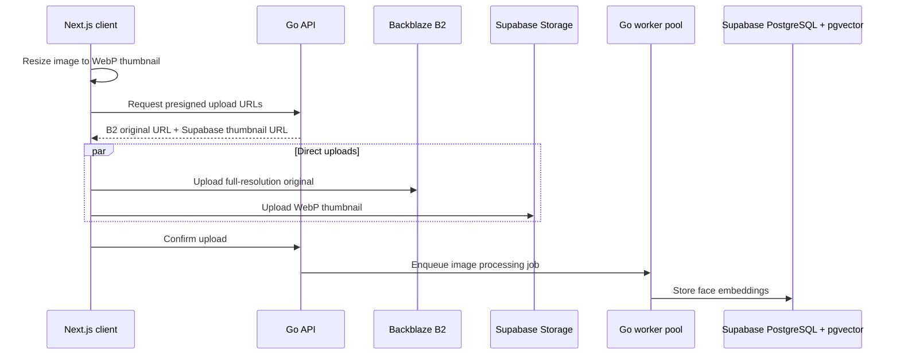

# pickME

> AI-powered biometric and semantic photo sharing for event groups.

  

pickME is designed for shared event photo groups, with photos clustered and filtered using face embeddings. The target architecture uses a free-tier cloud stack, a stateless Go API, and direct-to-storage uploads so image bytes do not pass through the API server.

> **Implementation status:** The repository currently contains the Go API, groups endpoints, health check, and multipart upload validation. The Next.js app, authentication middleware, direct uploads, and biometric processing described below are planned architecture.

## Architecture and upload flow

The following is the planned upload flow. The current `POST /api/upload` endpoint accepts multipart uploads; presigned upload endpoints are not implemented yet.



## Tech stack

| Layer | Technology | Purpose |
|---|---|---|
| Backend | Go 1.22+, `net/http`, `pgx/v5`, `godotenv` | HTTP API and PostgreSQL connection pooling |
| Async processing | Bounded Go worker pool and buffered channels | Process confirmed uploads outside request handling |
| Frontend | Next.js, TypeScript | Group and photo sharing UI; create WebP thumbnails client-side |
| Database and auth | Supabase PostgreSQL, `pgvector`, Supabase Auth | Group data, face embeddings, and Google Sign-In (`signInWithIdToken`) |
| Original image storage | Backblaze B2, S3-compatible presigned URLs | Store full-resolution photos |
| Thumbnail storage | Supabase Storage, presigned uploads | Serve lightweight WebP thumbnails in gallery grids |

## Project structure

Current and planned backend layout:

```text
server/
├── cmd/
│   └── api/main.go             # Entry point, dependency setup, route registration
└── internal/
    ├── handlers/               # health.go, groups.go, upload.go
    ├── middleware/              # auth.go (planned Supabase JWT verification)
    ├── services/               # worker.go (placeholder worker pool; clustering planned)
    └── store/                  # db.go, groups.go
```

## Local development

### Prerequisites

- Go 1.22 or newer
- Node.js (for the planned Next.js frontend)
- Supabase project
- Backblaze B2 account (for planned original image storage)

The backend module currently declares Go 1.26.10 in `server/go.mod`.

### Configuration

Create `server/.env` for local development:

```dotenv
DATABASE_URL=postgresql://postgres:<password>@<host>:5432/postgres
SUPABASE_URL=https://<project-ref>.supabase.co
SUPABASE_ANON_KEY=<supabase-anon-key>
SUPABASE_SERVICE_ROLE_KEY=<supabase-service-role-key>
B2_ENDPOINT=<s3-compatible-endpoint>
B2_BUCKET=<bucket-name>
B2_KEY_ID=<application-key-id>
B2_APPLICATION_KEY=<application-key>
```

The backend reads `DATABASE_URL` and `SUPABASE_URL`; the latter is used to verify ES256 access tokens through Supabase's JWKS endpoint. The remaining values are placeholders for planned auth and storage integrations. URL-encode special characters in database credentials; for example, encode `@` as `%40` in `DATABASE_URL`.

### Database

The groups store expects `id`, `name`, and `created_at` columns. This example includes the planned `owner_id`; ownership is not currently used by the API.

```sql
create table groups (
    id uuid primary key default gen_random_uuid(),
    owner_id uuid not null,
    name text not null,
    created_at timestamptz not null default now()
);
```

### Run the backend

```sh
cd server
go run cmd/api/main.go
```

The API listens on `:8080`. An `air` command is also possible if Air is installed and configured locally.

## API endpoints

| Method | Path | Status | Purpose |
|---|---|---|---|
| `GET` | `/health` | Implemented | Health check |
| `POST` | `/api/groups` | Implemented | Create a group |
| `GET` | `/api/groups` | Implemented | List groups |
| `POST` | `/api/upload` | Implemented | Validate multipart photo and enqueue placeholder job |
| `POST` | `/api/uploads/presign` | Planned | Request direct upload URLs |
| `POST` | `/api/uploads/complete` | Planned | Confirm uploaded objects and enqueue processing |

## Roadmap

- [x] Health check
- [x] Supabase PostgreSQL connection pool
- [x] Groups API
- [x] Multipart upload size and content-type validation
- [ ] Supabase Google Sign-In and JWT verification middleware
- [ ] Presigned direct uploads to Backblaze B2 and Supabase Storage
- [ ] Face embedding worker and `pgvector` storage
- [ ] WebSocket updates for processing and gallery changes
