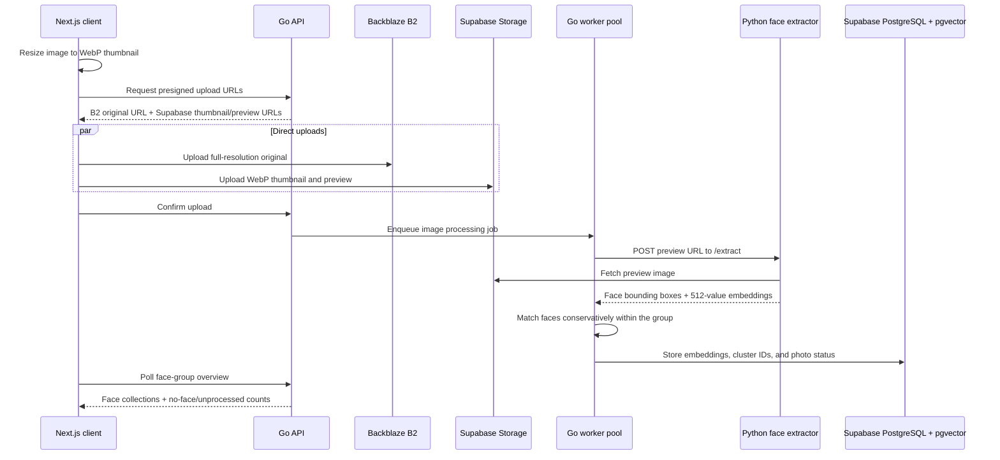

# pickME

> AI-powered biometric and semantic photo sharing for event groups.

  

pickME is designed for shared event photo groups, with photos clustered and filtered using face embeddings. The target architecture uses a free-tier cloud stack, a stateless Go API, and direct-to-storage uploads so image bytes do not pass through the API server.

> **Implementation status:** The Go API supports Supabase JWT authentication, shared groups with owner-managed invite links, direct-to-storage uploads, original downloads, asynchronous face extraction, group-scoped face clustering, and face/no-face galleries. Existing photos are kept in an Unprocessed collection; clustering applies to uploads processed after the migration.

## Architecture and upload flow

The client creates two WebP derivatives, uploads them to the public Supabase `media` bucket, and sends the full-resolution original directly to the private Backblaze B2 bucket. The Go API handles only metadata and presigned URLs.



## Tech stack

| Layer | Technology | Purpose |
|---|---|---|
| Backend | Go 1.22+, `net/http`, `pgx/v5`, `godotenv` | HTTP API and PostgreSQL connection pooling |
| Async processing | Bounded Go worker pool and buffered channels | Process confirmed uploads outside request handling |
| Face extraction | Python, FastAPI, InsightFace | Detect faces and produce normalized 512-dimensional embeddings |
| Frontend | Next.js, TypeScript | Group and photo sharing UI; create WebP thumbnails client-side |
| Database and auth | Supabase PostgreSQL, `pgvector`, Supabase Auth | Group data, face embeddings, and Google Sign-In (`signInWithIdToken`) |
| Original image storage | Backblaze B2, S3-compatible presigned URLs | Store full-resolution photos |
| Thumbnail storage | Supabase Storage, presigned uploads | Serve lightweight WebP thumbnails in gallery grids |

## Project structure

Current and planned backend layout:

```text
server/
├── cmd/
│   └── api/main.go             # Entry point, dependency setup, route registration
├── migrations/
│   ├── 003_face_clusters.sql   # Cluster table and embedding link
│   └── 004_face_group_search_index.sql # Exact group-scoped face matching
└── internal/
    ├── handlers/               # health.go, groups.go, upload.go
    ├── middleware/             # auth.go (Supabase ES256 JWT verification)
    ├── services/               # worker.go, face_extractor.go, photo_processor.go
    ├── storage/                # clients.go (B2 and Supabase S3 presigning)
    ├── store/                  # db.go, groups.go, photos.go
```

## Local development

### Prerequisites

- Go 1.22 or newer
- Node.js
- Supabase project
- Backblaze B2 account

The backend module currently declares Go 1.26.10 in `server/go.mod`.

### Configuration

Create `server/.env` for local development:

```dotenv
DATABASE_URL=postgresql://postgres:<password>@<host>:5432/postgres
SUPABASE_URL=https://<project-ref>.supabase.co
SUPABASE_ANON_KEY=<supabase-anon-key>
SUPABASE_S3_REGION=<supabase-s3-region>
SUPABASE_S3_ENDPOINT=https://<project-ref>.supabase.co/storage/v1/s3
SUPABASE_S3_KEY_ID=<supabase-s3-access-key-id>
SUPABASE_S3_SECRET=<supabase-s3-secret-access-key>
SUPABASE_BUCKET=media
B2_REGION=<b2-s3-region>
B2_ENDPOINT=https://s3.<region>.backblazeb2.com
B2_KEY_ID=<application-key-id>
B2_APP_KEY=<application-key>
B2_BUCKET=pickme-originals
FACE_EXTRACTOR_URL=http://localhost:8000
FACE_MATCH_THRESHOLD=0.50
```

The backend reads `DATABASE_URL`, `SUPABASE_URL`, the storage settings, and `FACE_EXTRACTOR_URL`. The face extractor must be reachable by the Go backend and able to fetch the public Supabase preview URL. `SUPABASE_URL` is used to verify ES256 access tokens through Supabase's JWKS endpoint. URL-encode special characters in database credentials; for example, encode `@` as `%40` in `DATABASE_URL`.

Create the public Supabase `media` bucket and configure browser CORS on both storage providers for the frontend origin. The storage credentials need permission to delete objects for group deletion. The embedding table must already exist with `photo_id`, `group_id`, `bbox integer[]`, and `embedding vector(512)` columns as described below. Apply `server/migrations/003_face_clusters.sql` after the `groups`, `photos`, and `face_embeddings` tables exist, then apply `server/migrations/004_face_group_search_index.sql`. Set `FACE_MATCH_THRESHOLD` between `0` and `1`; the default `0.50` may need tuning for the extractor/model and your photos.

Add the frontend origin and its `/invite/*` path to Supabase Auth's allowed redirect URLs so Google sign-in can return invitees to the invitation they opened.

### Database

Groups are created by an owner. Owners can create one seven-day invite link per group; signed-in users can reuse that link to join until it expires. A new link can be created after the active one expires. Members can view, upload, and download group photos. Only the owner can delete the group or manage members. Group access is always checked against the verified Supabase JWT identity.

The existing Supabase `media` bucket is public, so group membership protects API access but does not make a known thumbnail or preview URL private. Private image access would require changing the bucket and issuing signed read URLs.

```sql
create table groups (
    id uuid primary key default gen_random_uuid(),
    owner_id uuid not null references auth.users(id),
    name text not null,
    created_at timestamptz not null default now()
);
```

Ensure the `groups` table includes the `owner_id` column before running the API.

After creating the existing `groups` table, apply `server/migrations/005_group_sharing.sql` to add group membership and hashed, expiring invitation-token storage. Existing groups remain owned by their current owners and need no backfill. The corresponding `.down.sql` migration refuses to run while memberships or unexpired invitation links remain.

The face worker writes one row per detected face to `face_embeddings` using `photo_id`, `group_id`, `bbox integer[]`, and `embedding vector(512)`. Migration `003_face_clusters.sql` adds its `cluster_id` link and creates `face_clusters`; migration `004_face_group_search_index.sql` supports exact nearest-face matching within each group. A processed photo with no embedding rows appears under **No faces**. Photos present before that migration are marked **Unprocessed** and are not automatically reprocessed. The extractor's detection score is not stored.

### Run the backend

```sh
cd server
go run cmd/api/main.go
```

The API listens on `:8080`. An `air` command is also possible if Air is installed and configured locally.

Run the face extractor separately with its Python dependencies installed:

```sh
uvicorn main:app --app-dir ai --host 0.0.0.0 --port 8000
```

Set `FACE_EXTRACTOR_URL` to the extractor's base URL if it is not reachable at `http://localhost:8000`.

## API endpoints

| Method | Path | Status | Purpose |
|---|---|---|---|
| `GET` | `/health` | Implemented | Health check |
| `POST` | `/api/groups` | Implemented | Create a group |
| `GET` | `/api/groups` | Implemented | List groups |
| `DELETE` | `/api/groups/{id}` | Implemented | Delete an owned group and its stored photos |
| `POST` | `/api/groups/{id}/invites` | Implemented | Create the group's active owner-only invite link (reusable, expires after 7 days) |
| `GET` | `/api/groups/{id}/invites` | Implemented | Check whether the group has an active invite link and read its expiry |
| `GET` | `/api/groups/{id}/members` | Implemented | List the group owner and members |
| `DELETE` | `/api/groups/{id}/members/{memberID}` | Implemented | Remove a group member (owner-only) |
| `GET` | `/api/invites/{token}` | Implemented | View an invite link after signing in |
| `POST` | `/api/invites/{token}/accept` | Implemented | Accept a link and join a group |
| `POST` | `/api/uploads/presign` | Implemented | Request direct upload URLs for a group |
| `POST` | `/api/uploads/complete` | Implemented | Save uploaded photo metadata and enqueue processing |
| `GET` | `/api/groups/{id}/photos` | Implemented | List a group's photos |
| `GET` | `/api/groups/{id}/face-groups` | Implemented | List face collections, no-face/unprocessed counts, and active processing IDs |
| `GET` | `/api/groups/{id}/face-groups/{clusterID}/photos` | Implemented | List photos containing a face in that group |
| `GET` | `/api/groups/{id}/no-face-photos` | Implemented | List processed photos without detected faces |
| `GET` | `/api/groups/{id}/unprocessed-photos` | Implemented | List photos not run through the new face grouping flow |
| `GET` | `/api/photos/{id}/download` | Implemented | Request a temporary original download URL |

## Roadmap

- [x] Health check
- [x] Supabase PostgreSQL connection pool
- [x] Groups API
- [x] Direct uploads for thumbnails, previews, and originals
- [x] Owner-scoped photo downloads
- [x] Face extraction worker and `pgvector` embedding storage
- [x] Group-scoped face clustering and face/no-face collections for new uploads
- [x] Supabase Google Sign-In and JWT verification middleware
- [x] Presigned direct uploads to Backblaze B2 and Supabase Storage
- [ ] ZIP download for a face collection
- [ ] WebSocket updates for processing and gallery changes
