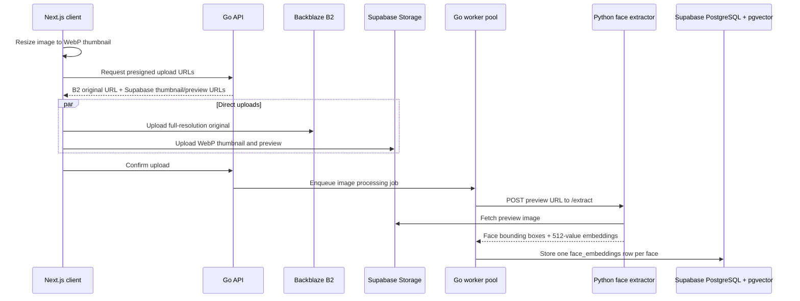

# pickME

> AI-powered biometric and semantic photo sharing for event groups.

  

pickME is designed for shared event photo groups, with photos clustered and filtered using face embeddings. The target architecture uses a free-tier cloud stack, a stateless Go API, and direct-to-storage uploads so image bytes do not pass through the API server.

> **Implementation status:** The repository contains a Go API with Supabase JWT authentication, user-owned groups, direct-to-storage uploads, photo metadata, original download signing, and an asynchronous face-extraction worker that stores face embeddings in pgvector. Semantic and identity-based clustering is planned.

## Architecture and upload flow

The client creates two WebP derivatives, uploads them to the public Supabase `media` bucket, and sends the full-resolution original directly to the private Backblaze B2 bucket. The Go API handles only metadata and presigned URLs.



## Tech stack

| Layer | Technology | Purpose |
|---|---|---|
| Backend | Go 1.22+, `net/http`, `pgx/v5`, `godotenv` | HTTP API and PostgreSQL connection pooling |
| Async processing | Bounded Go worker pool and buffered channels | Process confirmed uploads outside request handling |
| Face extraction | Python, FastAPI, InsightFace | Detect faces and produce normalized 512-dimensional embeddings |
| Frontend | Next.js, TypeScript | Group and photo sharing UI; create WebP thumbnails client-side |
| Database and auth | Supabase PostgreSQL, `pgvector`, Supabase Auth | Group data, face embeddings, and Google Sign-In (`signInWithIdToken`) |
| Original image storage | Backblaze B2, S3-compatible presigned URLs | Store full-resolution photos |
| Thumbnail storage | Supabase Storage, presigned uploads | Serve lightweight WebP thumbnails in gallery grids |

## Project structure

Current and planned backend layout:

```text
server/
├── cmd/
│   └── api/main.go             # Entry point, dependency setup, route registration
└── internal/
    ├── handlers/               # health.go, groups.go, upload.go
    ├── middleware/             # auth.go (Supabase ES256 JWT verification)
    ├── services/               # worker.go, face_extractor.go, photo_processor.go
    ├── storage/                # clients.go (B2 and Supabase S3 presigning)
    ├── store/                  # db.go, groups.go, photos.go
    └── migrations/             # owner-groups and photos schema
```

## Local development

### Prerequisites

- Go 1.22 or newer
- Node.js
- Supabase project
- Backblaze B2 account

The backend module currently declares Go 1.26.10 in `server/go.mod`.

### Configuration

Create `server/.env` for local development:

```dotenv
DATABASE_URL=postgresql://postgres:<password>@<host>:5432/postgres
SUPABASE_URL=https://<project-ref>.supabase.co
SUPABASE_ANON_KEY=<supabase-anon-key>
SUPABASE_S3_REGION=<supabase-s3-region>
SUPABASE_S3_ENDPOINT=https://<project-ref>.supabase.co/storage/v1/s3
SUPABASE_S3_KEY_ID=<supabase-s3-access-key-id>
SUPABASE_S3_SECRET=<supabase-s3-secret-access-key>
SUPABASE_BUCKET=media
B2_REGION=<b2-s3-region>
B2_ENDPOINT=https://s3.<region>.backblazeb2.com
B2_KEY_ID=<application-key-id>
B2_APP_KEY=<application-key>
B2_BUCKET=pickme-originals
FACE_EXTRACTOR_URL=http://localhost:8000
```

The backend reads `DATABASE_URL`, `SUPABASE_URL`, the storage settings, and `FACE_EXTRACTOR_URL`. The face extractor must be reachable by the Go backend and able to fetch the public Supabase preview URL. `SUPABASE_URL` is used to verify ES256 access tokens through Supabase's JWKS endpoint. URL-encode special characters in database credentials; for example, encode `@` as `%40` in `DATABASE_URL`.

Create the public Supabase `media` bucket and configure browser CORS on both storage providers for the frontend origin. Apply `server/migrations/002_photos.sql` after the groups ownership migration.

### Database

Groups are private to their creator. Delete existing group rows before applying the ownership migration. The API takes the owner from the verified Supabase JWT and never accepts an owner ID from the request body.

```sql
create table groups (
    id uuid primary key default gen_random_uuid(),
    owner_id uuid not null references auth.users(id),
    name text not null,
    created_at timestamptz not null default now()
);
```

Apply `server/migrations/001_groups_owner.sql` after clearing existing groups.

The face worker writes one row per detected face to the existing `face_embeddings` table using `photo_id`, `group_id`, `bbox integer[]`, and `embedding vector(512)`. The extractor's detection score is not stored.

### Run the backend

```sh
cd server
go run cmd/api/main.go
```

The API listens on `:8080`. An `air` command is also possible if Air is installed and configured locally.

Run the face extractor separately with its Python dependencies installed:

```sh
uvicorn main:app --app-dir ai --host 0.0.0.0 --port 8000
```

Set `FACE_EXTRACTOR_URL` to the extractor's base URL if it is not reachable at `http://localhost:8000`.

## API endpoints

| Method | Path | Status | Purpose |
|---|---|---|---|
| `GET` | `/health` | Implemented | Health check |
| `POST` | `/api/groups` | Implemented | Create a group |
| `GET` | `/api/groups` | Implemented | List groups |
| `POST` | `/api/uploads/presign` | Implemented | Request direct upload URLs for a group |
| `POST` | `/api/uploads/complete` | Implemented | Save uploaded photo metadata and enqueue processing |
| `GET` | `/api/groups/{id}/photos` | Implemented | List a group's photos |
| `GET` | `/api/photos/{id}/download` | Implemented | Request a temporary original download URL |

## Roadmap

- [x] Health check
- [x] Supabase PostgreSQL connection pool
- [x] Groups API
- [x] Direct uploads for thumbnails, previews, and originals
- [x] Owner-scoped photo downloads
- [x] Face extraction worker and `pgvector` embedding storage
- [ ] Semantic and identity-based face clustering
- [ ] Supabase Google Sign-In and JWT verification middleware
- [ ] Presigned direct uploads to Backblaze B2 and Supabase Storage
- [ ] WebSocket updates for processing and gallery changes
